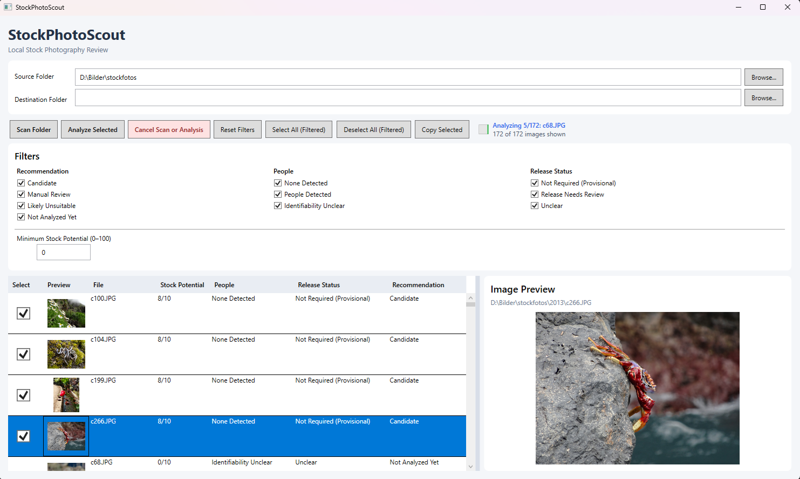

# StockPhotoScout

AI-powered stock photo discovery tool that scans photo archives and identifies promising images without modifying originals.

Uses **Qwen2.5-VL 7B** via [Ollama](https://ollama.com/) to analyze images for commercial stock potential, people, release considerations, and recommendations.

## Screenshot



## Features

- Scan folders for images
- AI-powered image analysis
- Stock potential scoring (1–10)
- Filter images by recommendation, people, and release status
- Copy selected images without changing the originals

## Requirements

- Windows
- .NET 9
- [Ollama](https://ollama.com/) with `qwen2.5vl:7b`

## Usage

1. Install Ollama and pull the model:
   ```bash
   ollama pull qwen2.5vl:7b
   ```
2. Start Ollama.
3. Build and run StockPhotoScout.
4. Select a photo folder and start the analysis.